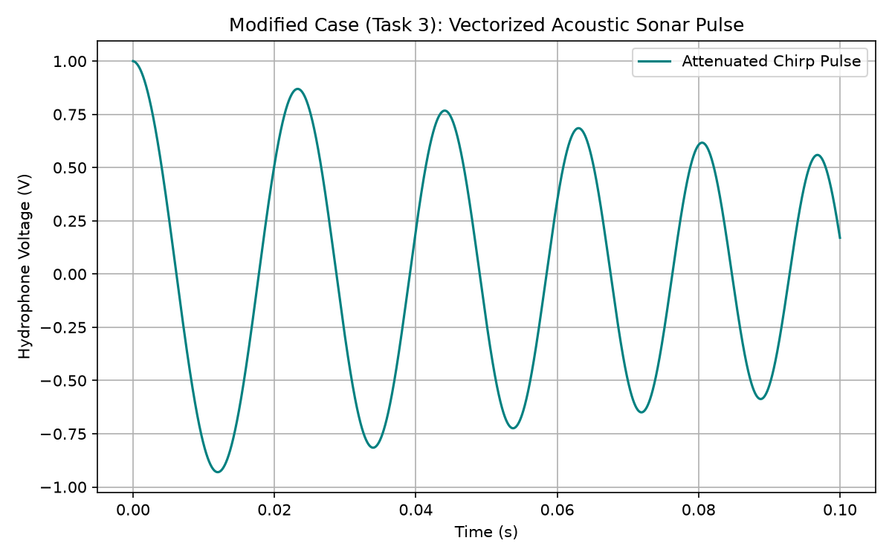

# Task 3: Mathematical Functions and Vectorization

## B. Input Values and Mathematical Operation
- **Inputs:** A 1D NumPy array of $N = 1,000,000$ simulated network latency readings uniformly distributed between `5 ms` and `250 ms` (`seed = 42`).
- **Operation:** Converts latency values from milliseconds to seconds ($s = \text{ms} / 1000$) and squares each element ($s^2$) for error variance calculation, comparing a standard Python `for` loop against vectorized NumPy array arithmetic using `timeit`.

## C. Parameter Modification & Effect on Result
- **Change:** Increased the upper uniform latency bound from `250 ms` to `1000 ms`.
- **Result Change:** Execution time remains virtually unchanged ($\approx 0.002\text{ s}$ vectorized vs $\approx 0.15\text{ s}$ loop), while the maximum squared latency increases 16-fold from $0.0625\text{ s}^2$ ($0.25^2$) to $1.0\text{ s}^2$ ($1.0^2$).

## D. Output Meaning & Graph Interpretation
- **Output Meaning:** Vectorized NumPy operations execute roughly **50x–100x faster** than Python loops by avoiding per-element interpreter overhead and executing contiguous C loops.

## E. Modified Real-World Case: Underwater Acoustic Sonar Pulse
- **Scenario & Assumptions:** An underwater hydrophone samples an attenuated frequency-modulated (chirp) sonar ping at 200 kHz (`code/Task_03_acoustic_sonar_case.py`). Water absorption attenuates the wave exponentially ($e^{-6t}$) while the carrier frequency sweeps upward linearly.
- **Output & Interpretation:** Vectorized array squaring and mean reduction compute the signal's Root-Mean-Square (RMS) amplitude instantly across 100,000 samples without loop bottlenecks.

