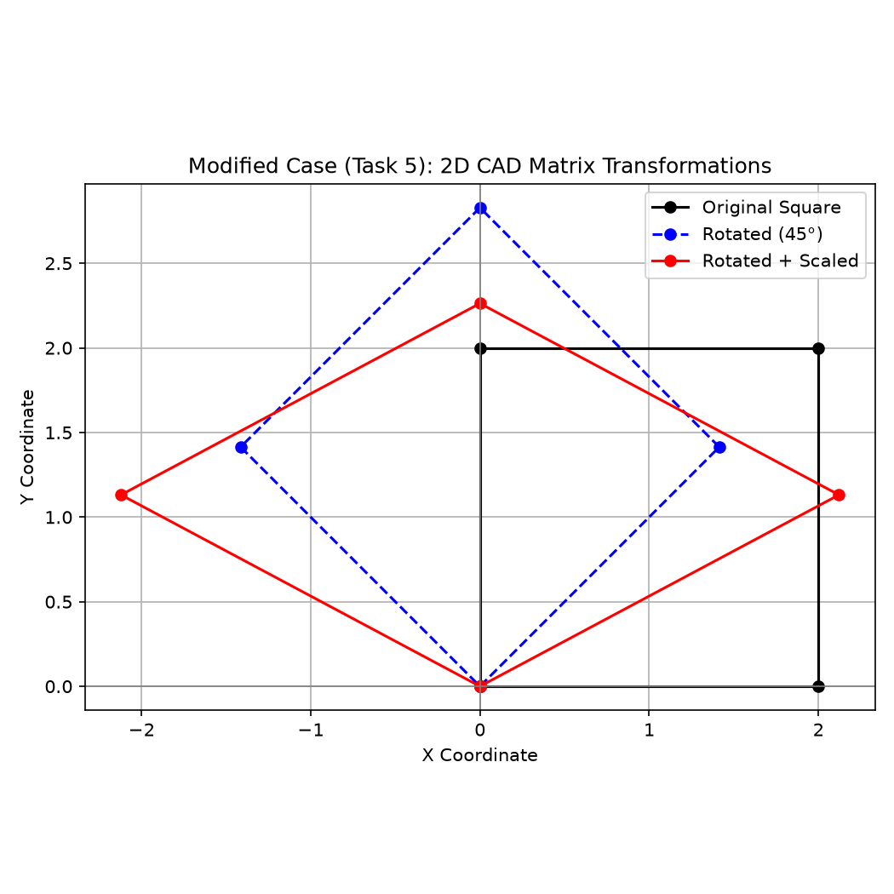

# Task 5: Matrix Algebra and Vector Operations

## B. Input Values and Mathematical Operation
- **Inputs:** Four 2D corner coordinates of a unit square `[[0,0], [1,0], [1,1], [0,1]]`, a $45^\circ$ rotation matrix $R$, and an anisotropic scaling matrix $S = \text{diag}(2.0, 1.5)$.
- **Operation:** Combines the linear transformations via matrix multiplication ($T = R \cdot S$), transforms all vertex rows simultaneously via $P' = P \cdot T^T$, and computes $\det(T)$.

## C. Parameter Modification & Effect on Result
- **Change:** Increased the rotation angle from $45^\circ$ ($\pi/4\text{ rad}$) to $90^\circ$ ($\pi/2\text{ rad}$).
- **Result Change:** The unit square rotates onto the negative $x$-axis (`[0,0], [0,2], [-1.5,2], [-1.5,0]`), while $\det(T)$ remains invariant at `3.0` ($2.0 \times 1.5$) because rotation matrices are orthogonal with determinant `1.0`.

## D. Output Meaning & Graph Interpretation
- **Output Meaning:** Matrix multiplication allows multiple geometric transformations (scaling and rotation) to be composed into a single operator $T$ whose determinant equals the net area scaling factor.

## E. Modified Real-World Case: 2D CAD / Robotics Rigid-Body Transformations
- **Scenario & Assumptions:** Transforming a 2D planar component in CAD/robotics using an orthogonal rotation matrix $R(45^\circ)$ composed with an anisotropic scaling matrix $S$ (`code/Task_05_2d_rotation_case.py`).
- **Output & Interpretation:** Because $R$ is orthogonal, $\det(R) = 1.0$, meaning pure rotation preserves geometric area and vector lengths. Composing $S \cdot R$ scales the polygon's area by $\det(S \cdot R) = 1.5 \times 0.8 = 1.2$.

