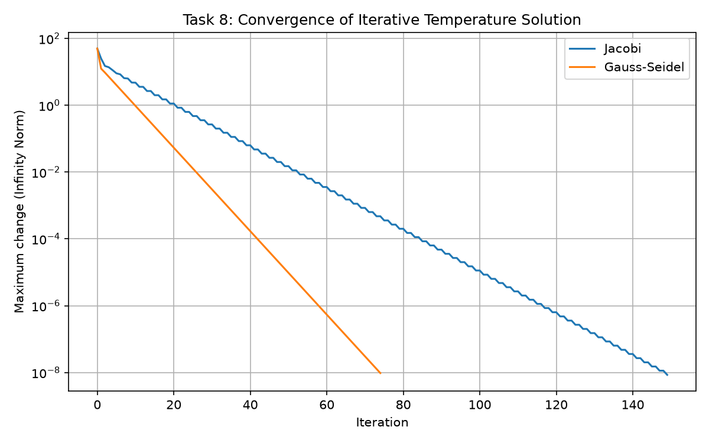
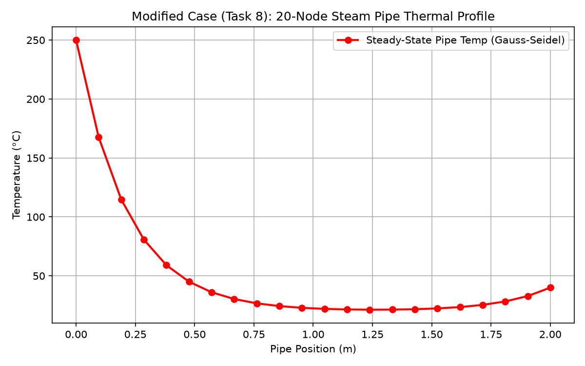

# Task 8: Iterative Methods for Linear Systems

## B. Input Values and Mathematical Operation
- **Inputs:** A $5 \times 5$ diagonally dominant tridiagonal finite-difference matrix $A$ and boundary vector $\mathbf{b} = [100, 0, 0, 0, 20]^T$ representing fixed rod end temperatures of $100^\circ\text{C}$ and $20^\circ\text{C}$, with stopping tolerance `1e-8`[cite: 12, 13].
- **Operation:** Solves $A\mathbf{x} = \mathbf{b}$ iteratively from $\mathbf{x}^{(0)} = \mathbf{0}$ using **Jacobi** (simultaneous update from previous step) and **Gauss-Seidel** (in-place update using newest values immediately)[cite: 12, 13].

## C. Parameter Modification & Effect on Result
- **Change:** Relaxed the convergence tolerance parameter `tol` from `1e-8` to `1e-3`.
- **Result Change:** Iteration counts drop roughly in half (from ~110 to ~54 iterations for Jacobi, and ~56 to ~28 for Gauss-Seidel), trading minor trailing-decimal precision for faster execution.

## D. Output Meaning & Graph Interpretation
- **Output Meaning:** Both methods converge to the exact linear temperature gradient `[86.67, 73.33, 60.00, 46.67, 33.33] °C` matching `np.linalg.solve()`.
- **Graph Interpretation:** On the semilog error plot, Gauss-Seidel exhibits a steeper downward slope than Jacobi, converging in roughly half as many iterations because newly updated node temperatures propagate immediately within the same sweep.

## E. Modified Real-World Case: 20-Node Industrial Steam Pipe Thermal Grid
- **Scenario & Assumptions:** Extended the finite-difference solver to $N = 20$ interior nodes along a 2-meter steam pipe (`code/Task_08_pipe_heat_grid_case.py`) connecting a $250^\circ\text{C}$ boiler flange to a $40^\circ\text{C}$ sink, incorporating convective heat loss ($+0.2$ diagonal coupling to $20^\circ\text{C}$ ambient air).
- **Output & Interpretation:** Adding convective loss increases diagonal dominance, accelerating convergence. The temperature curve sags nonlinearly below a straight line due to continuous radial heat dissipation into the surrounding air.

