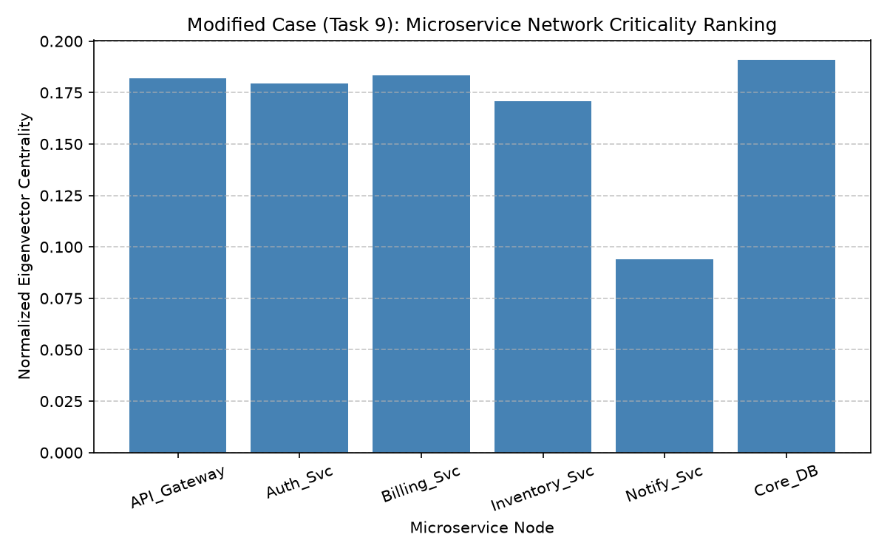

# Task 9: Eigenvalues and Eigenvectors

## B. Input Values and Mathematical Operation
- **Inputs:** A $4 \times 4$ symmetric binary adjacency matrix $A$ representing undirected edges between nodes `A, B, C, D`.
- **Operation:** Computes eigenvalues and eigenvectors via `np.linalg.eig(A)`, extracts the dominant (largest real) eigenvalue $\lambda_{\max}$ and its corresponding eigenvector $\mathbf{v}_{\max}$, and normalizes $\mathbf{v}_{\max}$ so its entries sum to `1.0`.

## C. Parameter Modification & Effect on Result
- **Change:** Added a direct undirected connection between peripheral nodes `A` and `D` ($A_{0,3} = A_{3,0} = 1.0$).
- **Result Change:** Every node now has an identical degree of 3 (a regular complete $K_4$ graph), increasing the dominant eigenvalue from `2.561553` to `3.000000` and equalizing all four node importance scores to `0.2500`.

## D. Output Meaning & Graph Interpretation
- **Output Meaning:** In the baseline network, hub nodes `B` and `C` each hold `0.2958` centrality while peripheral nodes `A` and `D` hold `0.2042`, because `B` and `C` connect to three neighbors instead of two. The residual $\|A\mathbf{v} - \lambda\mathbf{v}\|_2 \approx 10^{-16}$ confirms spectral exactness.

## E. Modified Real-World Case: Enterprise Microservice Criticality Analysis
- **Scenario & Assumptions:** Modeling a 6-node microservice architecture (`code/Task_09_microservice_centrality_case.py`) using a weighted symmetric traffic matrix $W$ to identify single points of failure.
- **Output & Interpretation:** `Core_DB` and `API_Gateway` emerge with the highest eigenvector centrality scores because they handle heavy traffic from other high-traffic hubs (`Auth_Svc`, `Billing_Svc`, `Inventory_Svc`), guiding infrastructure auto-scaling and redundancy priorities.

