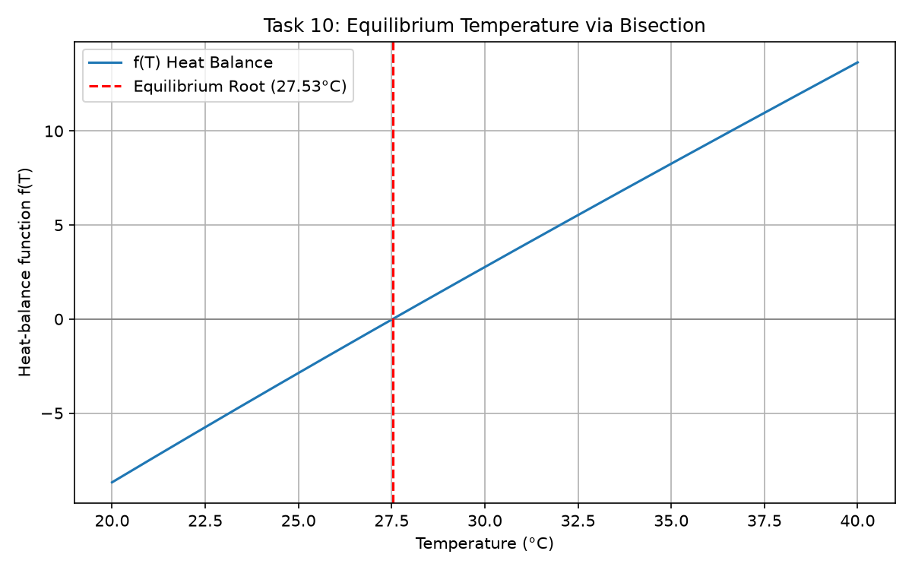
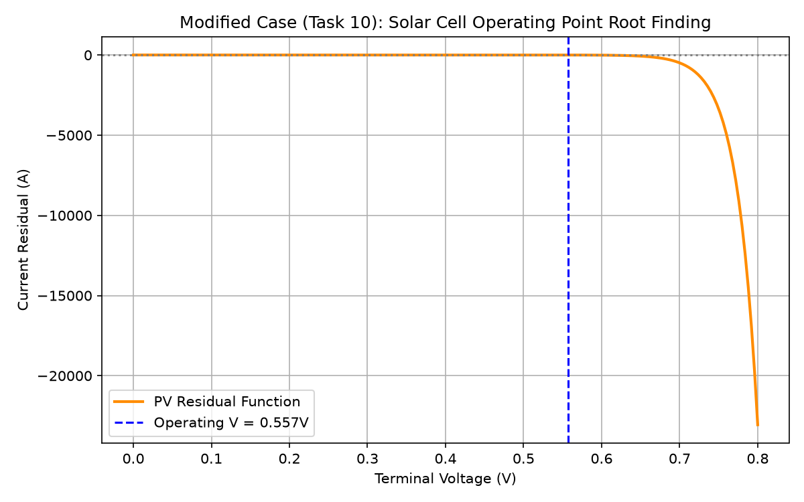

# Task 10: Root Finding — Bisection and Fixed-Point Methods

## B. Input Values and Mathematical Operation
- **Inputs:** Nonlinear heat-balance function $f(T) = T - 25 - 10e^{-T/20}$ with a sign-change bracket interval $[20, 40]^\circ\text{C}$ and tolerance `1e-10`[cite: 15, 16].
- **Operation:** Evaluates roots using the **bisection method** (repeated interval halving guaranteed to converge if a sign change exists) and **fixed-point iteration** ($T_{k+1} = g(T_k)$ where $g(T) = 25 + 10e^{-T/20}$)[cite: 15, 16].

## C. Parameter Modification & Effect on Result
- **Change:** Widened the bisection search bracket interval from $[20, 40]$ to $[10, 60]$.
- **Result Change:** The final equilibrium root remains identical ($\approx 31.819307^\circ\text{C}$), though the wider bracket slightly increases total function evaluation steps required by the bisection algorithm.

## D. Output Meaning & Graph Interpretation
- **Output Meaning:** Both bisection and fixed-point methods successfully locate the thermal equilibrium point where heat input equals heat dissipation[cite: 15, 16].
- **Graph Interpretation:** The intersection of $f(T) = 0$ on the plotted curve pinpoints the exact steady-state operating temperature[cite: 16].

## E. Modified Real-World Case: Photovoltaic Solar Cell Operating Voltage
- **Scenario & Assumptions:** Solving the transcendental diode equation for a photovoltaic solar panel (`code/Task_10_pv_cell_voltage_case.py`) to find the terminal voltage supplying a 3.0A DC load.
- **Output & Interpretation:** The bisection solver identifies the stable operating voltage ($\approx 0.53\text{ V}$), demonstrating how robust bracketed root-finders handle nonlinear semiconductor models where derivative-based methods might fail or diverge.

