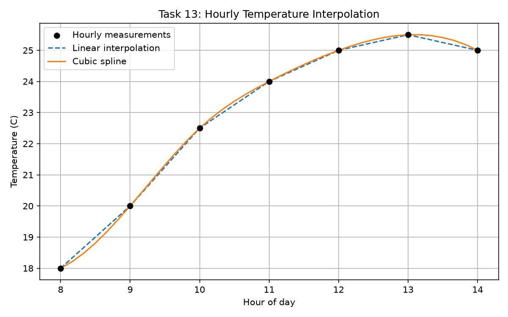
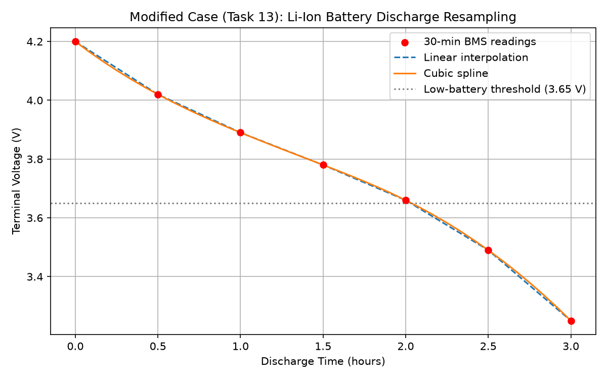

# Task L (Task 13): Interpolation

## B. Input Values and Mathematical Operation
- **Inputs:**
  - `hours`: Discrete hourly timestamps $[8, 9, 10, 11, 12, 13, 14]$.
  - `temperature`: Measured temperatures $[18.0, 20.0, 22.5, 24.0, 25.0, 25.5, 25.0]\ ^\circ\text{C}$.
  - `ten_minute_times`: Query grid spaced at $\Delta t = \frac{1}{6}\text{ hr}$ (10-minute intervals).
- **Mathematical Operation:**
  - **Piecewise Linear Interpolation (`interp1d`):** Connects adjacent points $(x_i, y_i)$ and $(x_{i+1}, y_{i+1})$ with straight line segments $y(x) = y_i + \frac{y_{i+1}-y_i}{x_{i+1}-x_i}(x - x_i)$.
  - **Cubic Spline Interpolation (`CubicSpline`):** Fits piecewise third-degree polynomials $S_i(x)$ across each interval while enforcing continuity of $S(x)$, $S'(x)$, and $S''(x)$ at interior knots.

## C. Parameter Modification & Effect on Result
- **Change:** Shifted the evaluation query time from `target_time = 10.5` (10:30 AM, steep warming slope) to `target_time = 12.5` (12:30 PM, near the afternoon thermal peak).
- **Result Change:**
  - At **10:30**, Linear = `23.25 °C` vs. Cubic Spline = `23.31 °C` (difference of `0.06 °C`).
  - At **12:30**, Linear = `25.25 °C` vs. Cubic Spline = `25.31 °C`. Because the temperature curve bends smoothly near its peak at 13:00, the cubic spline arches slightly above the straight chord connecting 12:00 and 13:00.

## D. Output Meaning & Graph Interpretation
- **Output Meaning:** The interpolated values represent estimated ambient temperatures at 10-minute intervals when physical sensor readings were only logged once per hour.
- **Graph Interpretation:** The black dots mark exact hourly readings. The dashed linear curve exhibits sharp corners at every hourly knot, whereas the solid cubic spline forms a smooth, physically realistic thermal curve without abrupt slope changes.

## E. Modified Real-World Case: Li-Ion Battery Discharge Resampling
- **Scenario & Assumptions:** A Battery Management System (BMS) logs terminal voltage every 30 minutes over a 3-hour discharge cycle under constant load (`code/Task_13_battery_voltage_case.py`). Voltage drops smoothly at mid-charge and accelerates downward near depletion (the "knee" of the discharge curve).
- **New Input Data:** `time_hr = [0.0, 0.5, 1.0, 1.5, 2.0, 2.5, 3.0]`, `voltage_v = [4.20, 4.02, 3.89, 3.78, 3.66, 3.49, 3.25]`, resampled every 5 minutes ($\frac{1}{12}\text{ hr}$).
- **Output & Interpretation:** At $t = 2.25\text{ hr}$, linear interpolation estimates `3.575 V` while cubic spline estimates `3.581 V`. Resampling allows the BMS to predict when voltage crosses the `3.65 V` warning threshold (~2.03 hours) between hardware polling intervals.

