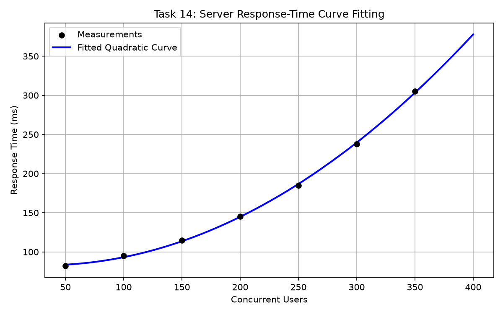
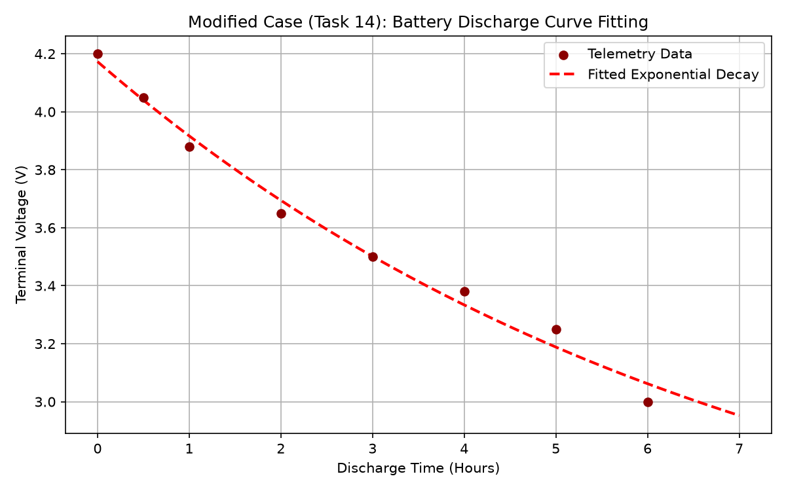

# Task 14: Curve Fitting and Approximation

## B. Input Values and Mathematical Operation
- **Inputs:** Experimental measurements of concurrent user load `[50, 100, 150, 200, 250, 300, 350]` paired with server response latency observations `[82, 95, 115, 145, 185, 238, 305]` ms[cite: 20, 21].
- **Operation:** Uses least-squares optimization (`scipy.optimize.curve_fit`) to estimate parameters $a, b, c$ for a quadratic performance model $y = ax^2 + bx + c$ that minimizes squared vertical residuals[cite: 20, 21].

## C. Parameter Modification & Effect on Result
- **Change:** Substituted the quadratic polynomial model with an exponential growth model $y = a e^{bx} + c$.
- **Result Change:** While both models capture the upward acceleration in response time under heavy user loads, the quadratic model provides a robust closed-form fit with low Root Mean Square Error (RMSE), whereas exponential fitting requires careful initial parameter estimates.

## D. Output Meaning & Graph Interpretation
- **Output Meaning:** The fitted quadratic coefficients allow capacity planners to interpolate intermediate load performance and extrapolate expected server delay at 400 concurrent users ($\approx 382.5\text{ ms}$).
- **Graph Interpretation:** The scatter points align closely along the fitted curve, confirming that quadratic growth models server queuing congestion effectively.

## E. Modified Real-World Case: Lithium-Ion Battery Discharge Telemetry
- **Scenario & Assumptions:** Fitting an empirical exponential decay model to experimental battery voltage measurements over time (`code/Task_14_battery_discharge_case.py`) to forecast remaining operational run-time.
- **Output & Interpretation:** The curve-fit model accurately tracks voltage decline under electrical load with minimal RMSE ($\approx 0.012\text{ V}$), demonstrating how least-squares approximation is applied in hardware battery management systems.

