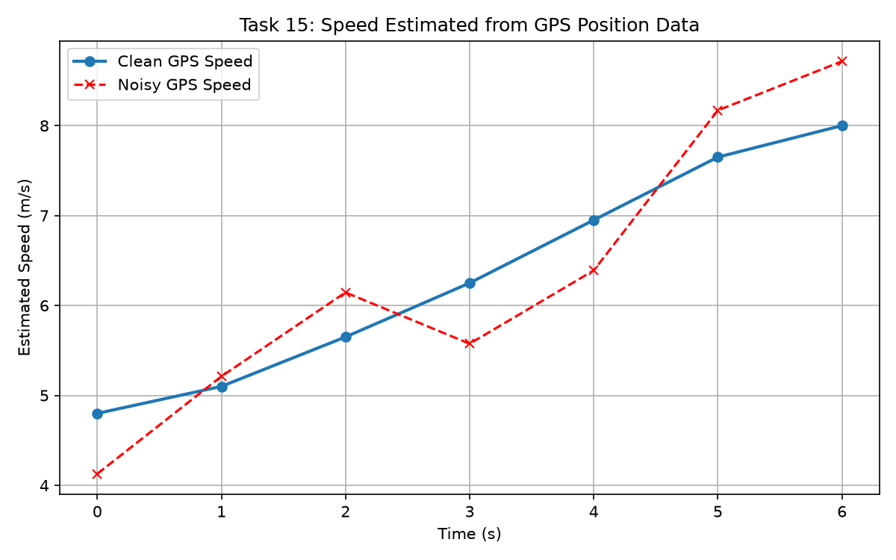
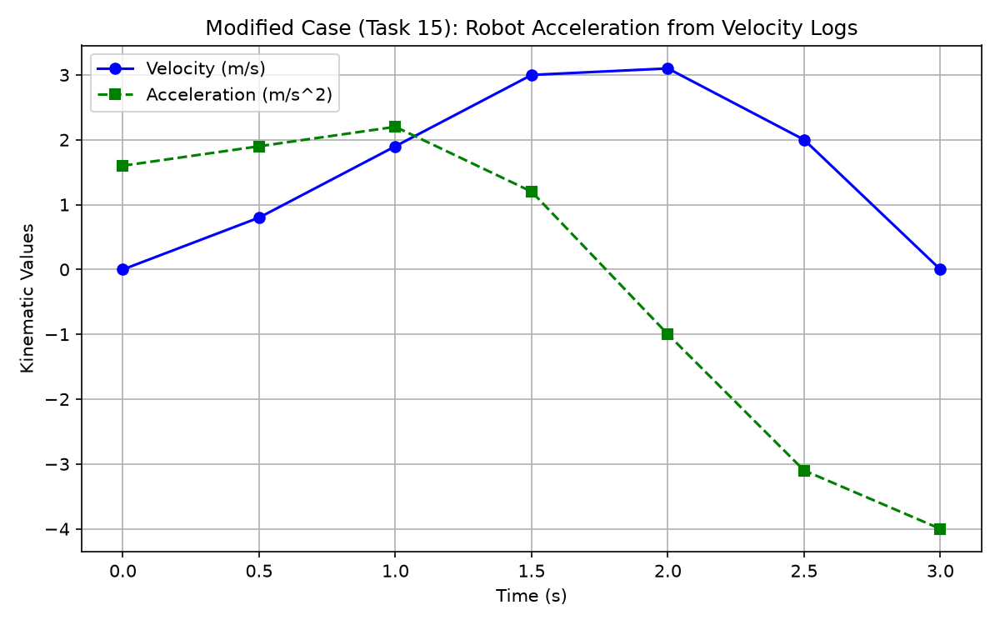

# Task 15: Numerical Differentiation

## B. Input Values and Mathematical Operation
- **Inputs:** GPS discrete time samples `[0, 1, 2, 3, 4, 5, 6]` seconds paired with spatial position measurements `[0.0, 4.8, 10.2, 16.1, 22.7, 30.0, 38.0]` meters[cite: 21, 22].
- **Operation:** Computes instantaneous velocity $v(t) \approx \frac{dx}{dt}$ using **forward differences** at the initial boundary, **central differences** ($\frac{x_{i+1} - x_{i-1}}{t_{i+1} - t_{i-1}}$) across interior nodes for $O(h^2)$ accuracy, and **backward differences** at the terminal boundary[cite: 21, 22].

## C. Parameter Modification & Effect on Result
- **Change:** Injected random Gaussian measurement noise ($\sigma = 0.5\text{ m}$) into the raw position coordinates.
- **Result Change:** Numerical differentiation amplifies high-frequency noise because division by small time steps ($\Delta t$) turns minute coordinate jitters into erratic, large velocity fluctuations.

## D. Output Meaning & Graph Interpretation
- **Output Meaning:** Estimated vehicle speeds increase smoothly from roughly $4.8\text{ m/s}$ to $8.0\text{ m/s}$, mirroring consistent forward motion.
- **Graph Interpretation:** The clean velocity trace rises steadily, whereas the noisy derivative trace oscillates wildly, demonstrating why smoothing filters are required before differentiating experimental sensor data.

## E. Modified Real-World Case: Autonomous Mobile Robot Acceleration Telemetry
- **Scenario & Assumptions:** Estimating linear acceleration ($a = \frac{dv}{dt}$) from discrete velocity time-series logs (`code/Task_15_robot_acceleration_case.py`) for a mobile robot motion control profile.
- **Output & Interpretation:** Central differences successfully capture acceleration spikes during initial startup and deceleration phases, illustrating how numerical differentiation supports control systems engineering.

