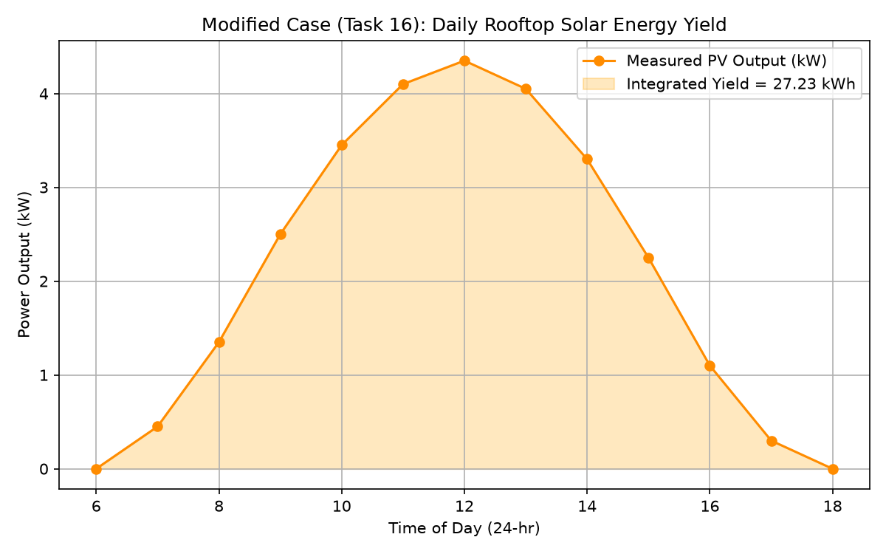

# Task O (Task 16): Numerical Integration

## B. Input Values and Mathematical Operation
- **Inputs:**
  - `time_hours`: Regular 2-hour timestamps $[0, 2, 4, 6, 8, 10, 12]\text{ hr}$.
  - `power_kw`: Smart-meter instantaneous power readings $[0.8, 1.0, 1.4, 1.8, 1.6, 1.2, 0.9]\text{ kW}$.
- **Mathematical Operation:** Approximates total energy $E = \int_{0}^{12} P(t)\,dt$ using:
  - **Trapezoidal Rule (`np.trapezoid`):** Sums trapezoid areas $\frac{h}{2}[P(t_i) + P(t_{i+1})]$ across subintervals.
  - **Simpson's Rule (`scipy.integrate.simpson`):** Fits quadratic parabolas across pairs of subintervals: $\frac{h}{3}[P(t_0) + 4P(t_1) + P(t_2)]$.

## C. Parameter Modification & Effect on Result
- **Change:** Increased the midday peak power reading at $t = 6\text{ hr}$ from `1.8 kW` to `2.6 kW` to simulate running a heavy appliance during peak hours.
- **Result Change:**
  - **Baseline (`1.8 kW` peak):** Trapezoidal = `15.700 kWh`, Simpson's = `15.867 kWh` (difference = `0.167 kWh`).
  - **Modified (`2.6 kW` peak):** Trapezoidal = `17.300 kWh`, Simpson's = `18.000 kWh` (difference = `0.700 kWh`). Increasing the sharp curvature at $t = 6\text{ hr}$ causes linear trapezoids to underestimate the parabolic peak much more noticeably than Simpson's rule.

## D. Output Meaning & Graph Interpretation
- **Output Meaning:** Integrating power (kW) over time (hours) yields total accumulated electrical energy consumed in kilowatt-hours (kWh), which directly determines utility billing.

## E. Modified Real-World Case: Daily Rooftop Solar PV Energy Yield
- **Scenario & Assumptions:** A 5 kW residential solar inverter logs active AC power output every hour from sunrise (06:00) to sunset (18:00) under clear-sky conditions (`code/Task_16_solar_generation_case.py`). Power is zero outside daylight hours.
- **New Input Data:** `hours = [6..18]`, `solar_kw = [0.0, 0.45, 1.35, 2.50, 3.45, 4.10, 4.35, 4.05, 3.30, 2.25, 1.10, 0.30, 0.0]`.
- **Output & Interpretation:** Both methods yield **27.200 kWh** (with Simpson's giving `27.233 kWh`, a `0.0333 kWh` difference due to hourly granularity). The shaded area under the curve in the generated graph visually represents total harvested solar energy for the day.

