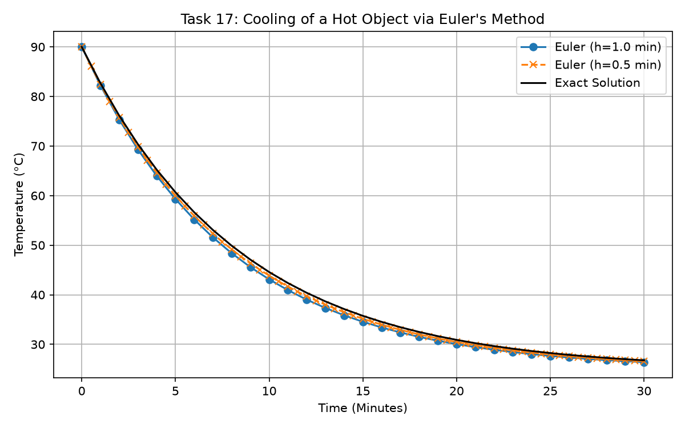
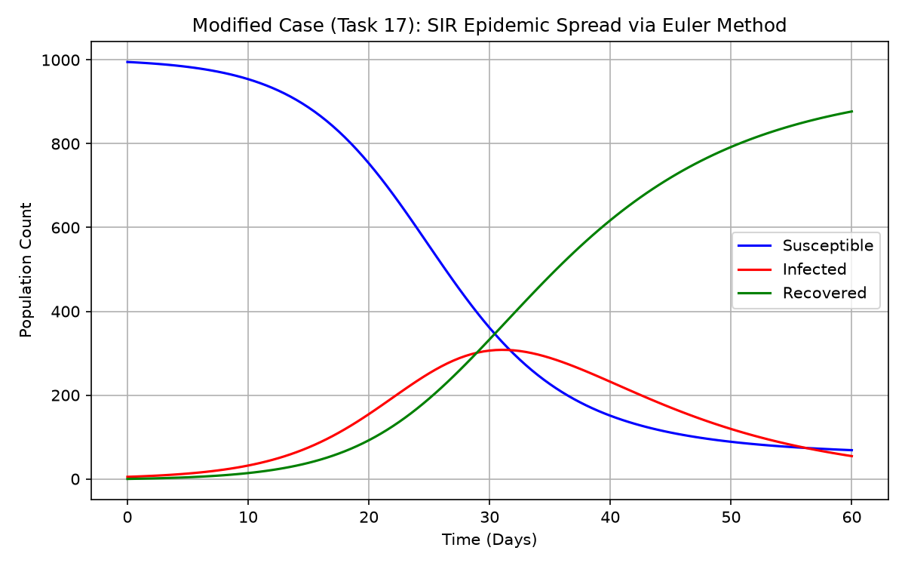

# Task 17: Ordinary Differential Equations — Euler Method

## B. Input Values and Mathematical Operation
- **Inputs:** Ambient temperature $T_{\text{ambient}} = 25^\circ\text{C}$, initial object temperature $T_{\text{initial}} = 90^\circ\text{C}$, cooling rate constant $k = 0.12$, step size $h = 1.0$ min, and integration span up to $30$ minutes[cite: 23, 24].
- **Operation:** Evaluates temperature progression using **Euler's explicit method** ($T_{k+1} = T_k + h f(t_k, T_k)$) and compares final approximations against the closed-form analytical solution[cite: 23, 24].

## C. Parameter Modification & Effect on Result
- **Change:** Halved the integration step size $h$ from $1.0$ minute down to $0.5$ minutes.
- **Result Change:** Reducing step size cuts global truncation error roughly in half, bringing the Euler estimate closer to the exact analytical curve ($29.35^\circ\text{C}$ vs $29.17^\circ\text{C}$).

## D. Output Meaning & Graph Interpretation
- **Output Meaning:** Euler's method tracks temperature exponential decay over time, though coarser step sizes accumulate slight truncation errors above the true analytical curve[cite: 23, 24].
- **Graph Interpretation:** The step-refined $h = 0.5$ trace hugs the exact black curve more closely than the $h = 1.0$ trace.

## E. Modified Real-World Case: SIR Epidemic Spread Simulation
- **Scenario & Assumptions:** Simulating infectious disease dynamics (`code/Task_17_epidemic_sir_case.py`) across a closed population using a system of coupled nonlinear ODEs solved via Euler iteration.
- **Output & Interpretation:** The model tracks the rise and fall of active infections over a 60-day window, illustrating how numerical ODE integration applies to public health forecasting.

