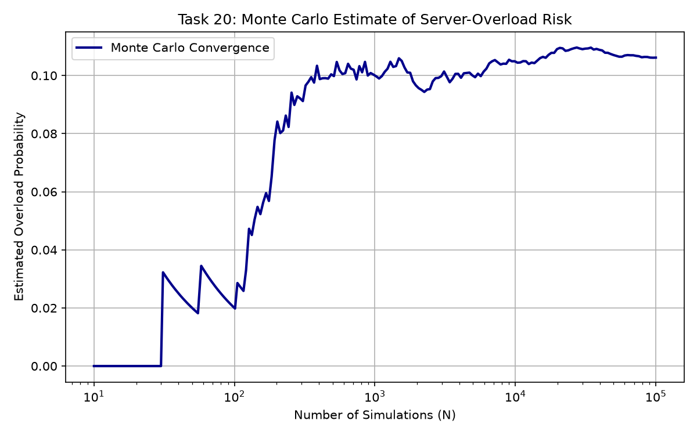
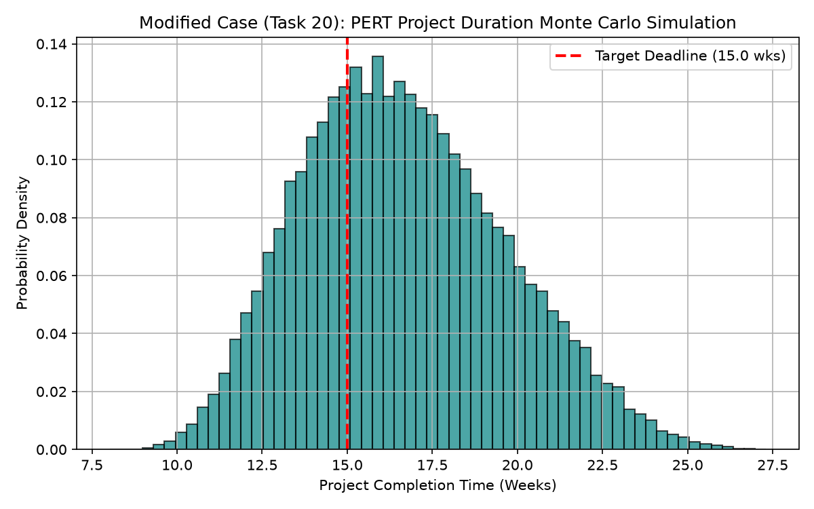

# Task 20: Random Numbers and Monte Carlo Methods

## B. Input Values and Mathematical Operation
- **Inputs:** Capacity threshold ($1,000.0$), mean incoming demand ($\mu = 850.0$), demand standard deviation ($\sigma = 120.0$), and total trial count ($N = 100,000$) sampled via pseudo-random number generator[cite: 29].
- **Operation:** Generates $N$ normally distributed random demand scenarios, evaluates whether each scenario exceeds system capacity ($\text{demand} > \text{capacity}$), and computes the overload probability as the fraction of overloaded simulations over total trials ($\text{overloaded.mean()}$)[cite: 29].

## C. Parameter Modification & Effect on Result
- **Change:** Increased demand standard deviation $\sigma$ from $120.0$ to $180.0$.
- **Result Change:** Widening the standard deviation increases the spread of incoming demand values into the distribution tails, significantly raising the computed server overload risk probability.

## D. Output Meaning & Graph Interpretation
- **Output Meaning:** The Monte Carlo simulation estimates the server overload probability across $100,000$ randomized trials[cite: 29].
- **Graph Interpretation:** The semilog convergence plot shows that the estimated running probability fluctuates initially with small sample sizes ($N < 100$) before stabilizing smoothly as $N$ approaches $100,000$, demonstrating the Law of Large Numbers[cite: 29, 30].

## E. Modified Real-World Case: PERT Project Duration Monte Carlo Simulation
- **Scenario & Assumptions:** Simulating project completion time uncertainty (`code/Task_20_project_completion_case.py`) across design, implementation, and testing phases using triangular distributions (optimistic, most likely, and pessimistic durations) across $50,000$ simulation trials.
- **Output & Interpretation:** The simulation calculates the mean project duration, 90th percentile schedule risk, and the probability of missing a target deadline, illustrating how Monte Carlo methods manage uncertainty in project management and engineering planning[cite: 29].

